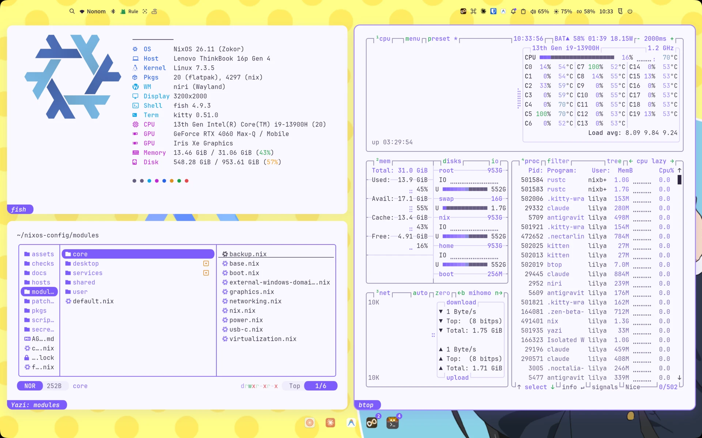

<div align="center">

# ❄️ lilya's NixOS Configuration

Declarative single-host **NixOS + Home Manager** flake for a Lenovo ThinkBook 16p Gen 4<br/>
running **Niri + Noctalia** (Catppuccin Lavender Light) with **Plasma Wayland** as fallback.

<p>
  <a href="https://nixos.org/"></a>
  <a href="https://github.com/YaLTeR/niri"></a>
  <a href="https://github.com/noctalia-dev/noctalia"></a>
  <a href="https://github.com/Konakonai/lilya-tools"></a>
</p>

<p>
  <a href="#hardware--stack">Stack</a> ·
  <a href="#repository-structure">Structure</a> ·
  <a href="#highlights">Highlights</a> ·
  <a href="#usage">Usage</a> ·
  <a href="#configuration-ownership">Ownership</a> ·
  <a href="#out-of-git-state--backups">State & Backups</a> ·
  <a href="#operational-notes">Notes</a> ·
  <a href="#external-infrastructure">External Docs</a>
</p>



</div>

> [!NOTE]
> This is a personal single-machine configuration containing host-specific hardware facts and encrypted secrets—do **not** run `nixos-rebuild switch` directly on another machine. Feel free to browse, borrow modules, or run exported packages.
> For automated agent conventions and workflow rules, read [AGENTS.md](AGENTS.md) first.

---

## Hardware & Stack

### Host (`hosts/lilya-thinkbook`)

| Spec | Value |
|---|---|
| **Machine** | Lenovo ThinkBook 16p Gen 4 (`21J8`) |
| **CPU / RAM** | Intel Core i9-13900H (6P + 8E) / 32 GiB RAM (+ zram zstd) |
| **GPUs** | Intel Iris Xe (iGPU) + NVIDIA GeForce RTX 4060 Laptop (PRIME offload, D3 runtime PM on battery) |
| **Displays** | Internal 16″ `3200×2000 @ 60 Hz` 10-bpc eDP (DSC via HBR2 ×2 link cap) · External Philips `27E2F7901` |

### Software Stack

| Layer | Components |
|---|---|
| **OS & Packaging** | NixOS (`nixos-unstable`), Flakes, Home Manager (integrated as NixOS module), `nh` |
| **Compositor & Shell** | [Niri](https://github.com/YaLTeR/niri) (primary) + [Noctalia](https://github.com/noctalia-dev/noctalia) · KDE Plasma Wayland (fallback via `plasma-manager`) |
| **Theme** | Catppuccin Lavender Light (`adw-gtk3`, `klassy` Qt6, Colloid icons, synced via Noctalia templates) |
| **Terminal & CLI** | Fish + Starship, Kitty, Yazi, Fastfetch, `btop`, `ripgrep`, `fd`, `direnv` |
| **Editor & Browsers** | Zed, Zen Browser (Beta), Brave Origin, Chromium |
| **Input Method** | Fcitx5 + Rime (`rime-ice`) + patched `fcitx5-configtool` |
| **Networking & Proxy** | Mihomo TUN (AWAvenue + GEOSITE rules), NetworkManager (Wi-Fi + USB LTE modem), Tailscale |
| **Phone & Media** | [NectarLink](https://github.com/thtbee/nectarlink) (webcam, uinput, clipboard, Tailscale QUIC), OpenList + rclone + Jellyfin, Beets |
| **Secrets & Backups** | `agenix` (`secrets/*.age`), daily `restic` to Seoul SFTP + Google Drive |
| **Companion Repos** | [`Konakonai/lilya-tools`](https://github.com/Konakonai/lilya-tools) (`music-discover`, `beets-zhlyrics`, `claude-token-band`), [`Konakonai/lanner`](https://github.com/Konakonai/lanner) |

---

## Repository Structure

All imports are explicit—no `lib/` abstraction layer and no directory auto-scanning. Cross-cutting features use **single-file dual-layer modules** (declaring both NixOS and `home-manager.users.<user>` options in one file).

```text
.
├── flake.nix                    # Inputs, overlays, nixosConfigurations.nixos, checks, packages, formatter
├── configuration.nix            # System entrypoint
├── home.nix                     # Minimal Home Manager base + external HM module imports
├── hosts/lilya-thinkbook/       # Machine facts: paths, displays, GPU PCI, USB devices, VM disk, age key
├── modules/
│   ├── default.nix              # Single top-level explicit import manifest
│   ├── shared/                  # theme-settings.nix (shared palette, fonts, radii)
│   ├── core/                    # System base: base, nix, boot, graphics, networking, power, usb-c, backup, virtualization
│   ├── services/                # Dual-layer services: mihomo/, media (OpenList/Jellyfin/rclone), nectarlink
│   ├── desktop/                 # Session & visuals: display/, fonts, fcitx5, niri/, noctalia, plasma, theme, mime
│   └── user/                    # Workflows & apps: shell, nixos-tools, packages, ai, gaming, music, apps/
├── pkgs/                        # Local packages & upstream overrides (exported as pkgs.lilya)
├── patches/                     # Minimal upstream patches (fcitx5-configtool, noctalia-mihomo-control)
├── scripts/ + scripts/tests/    # Standalone hardware/ops scripts & regression tests (SYSROOT-injectable)
├── checks/                      # Flake checks (lint, configuration regressions, niri KDL validation)
├── assets/ secrets/             # Static assets (wallpapers, templates, preview) & agenix secrets
└── docs/                        # Out-of-band external machine runbooks (music server, router, backup VPS)
```

---

## Highlights

- **Two-Layer Appearance Model** — Nix manages the default layer; GUI tweaks live in Noctalia's override layer (`~/.local/state/noctalia/settings.toml`) and survive rebuilds. Palette templates sync automatically to GTK, Qt, Niri, and Kitty.
- **Hardware & Power Tuning** — Battery-aware `power-profiles-daemon` UPower throttling is disabled (`--disable-upower`) so `balanced` stays responsive on battery, while explicit `power-saver` disables Intel turbo and sets PCIe ASPM to `powersupersave` with automatic rollback; NVIDIA dGPU sleeps in D3 only on battery; eDP link is capped at HBR2 ×2 for 10-bpc DSC (`-0.4 W` idle); USB-C PD mux resets recover stuck ports automatically.
- **Mihomo TUN + Anti-Leak Networking** — GEOSITE-driven routing fronted by AWAvenue + `category-ads-all` ad blocking, authenticated LAN mixed port (`7890`), host IPv6 enabled for direct Tailscale NAT traversal, and managed browser policies keeping WebRTC bound to the TUN interface with STUN forced over proxy.
- **Phone Integration (NectarLink)** — Single-file dual-layer setup with `v4l2loopback` virtual webcam, `/dev/uinput` remote input, pinned UDP `7718` QUIC endpoint opened only on Wi-Fi and `tailscale0`, and tray-ready systemd user autostart.
- **Media & Music Pipelines** — Quark cloud drive mounted via `OpenList → rclone → ~/Mounts/OpenList` for local user-scoped Jellyfin (exposed only on Wi-Fi and `tailscale0`); `beets` + `zhlyrics` organizes `~/Music`, `music-sync` mirrors to Shanghai Navidrome, and `music-discover` builds a weekly discovery page.
- **External Windows Passthrough VM** — `libvirt`/QEMU whole-disk USB passthrough with udev permissions (`UDISKS_AUTO=0`) and a safe launcher that refuses to boot while the disk is mounted on the host.
- **AI Toolchain & Background Computer Use** — Consolidated in [modules/user/ai.nix](modules/user/ai.nix): Antigravity (with context-meter injection), Claude Desktop (Electron 44 + `claude-cu-desk` headless Sway display), Codex Desktop (`nix-ld` + `ydotool`), `wlroots-bridge` + `sway-sandbox`, OpenCLI, `claude-token-band`, the [Lanner](https://github.com/Konakonai/lanner) usage monitor (token cost, speed and quota across agents), and the `gemini-frontend-design` skill (Claude Code + Antigravity).
- **Automated Regression Checks** — `statix`, `deadnix`, `nixfmt`, Python unit tests for hardware/proxy scripts & Mihomo rule reachability, plus `niri validate` on generated KDL.

---

## Usage

### Local Rebuild & Validation

```bash
rebuild          # nh os switch
testbuild        # nh os test (skip bootloader entry)
bootbuild        # nh os boot (use instead of rebuild for glibc / systemd / PAM upgrades)

nix fmt
nix flake check --no-build --no-update-lock-file
nix build .#checks.x86_64-linux.{configuration,lint,niri-config} --no-link

update-pins      # flake update + nix-update pinned pkgs + flatpak update (leaves diff uncommitted)
config-drift noctalia|zed   # inspect GUI overrides vs Nix default layer
```

### Exported Packages

Local derivations under `pkgs/` are exposed via `packages.x86_64-linux` (including `antigravity`, `codex-desktop`, `computer-use-linux`, `gemini-api`, `google-colab-cli`, `noctalia-mihomo-control`, `opencli`, `wlroots-bridge`, `touhou-grub-theme`, `touhou-plymouth-theme`, etc.):

```bash
nix flake show github:Konakonai/nixos-config
nix build github:Konakonai/nixos-config#<package>
```

---

## Configuration Ownership

**Rule:** Nix owns the default layer; GUIs own their override layer; activation never clobbers user overrides.

| Target | Ownership Strategy |
|---|---|
| Niri, keybinds, monitors, MIME, fonts, GTK/Qt theme files | Continuously managed by Nix |
| Noctalia `config.toml` / `settings.toml` | Nix default layer / GUI delta layer (`~/.local/state/noctalia/`) |
| Plasma keys declared via `plasma-manager` | Rewritten on activation; all other keys owned by Plasma |
| Zed `settings.json`, LibreOffice toolbars | Seeded once, then owned by the app |
| Jellyfin libraries & dashboard settings | Runtime state (`/var/lib/jellyfin`, excluded from backups); disable real-time monitoring, chapter images, and trickplay on cloud mounts |
| Flatpak apps, Noctalia community plugins | Runtime-installed, not pinned in `flake.lock` (except patched `mihomo-control`) |

Run `config-drift noctalia|zed` to inspect GUI drift when promoting changes back to Nix. If Noctalia templates fail to refresh, run `noctalia msg templates-apply`.

---

## Out-of-Git State & Backups

Not tracked in Git: `~/.config/age/mihomo.txt` (age identity and root of trust for all `secrets/*.age`), `~/.local/state/noctalia/settings.toml`, `~/.config/openlist/`, `~/.config/rclone/rclone.conf`, browser profiles, libvirt NVRAM/TPM state, and the external Windows disk. Full-disk encryption is intentionally omitted.

[modules/core/backup.nix](modules/core/backup.nix) runs daily `restic` backups (covering the above except browser profiles and the Windows disk, plus `~/.ssh` and `~/.gnupg`) to two encrypted remotes:
- **Seoul SFTP** (chrooted `restic` user): `sudo restic-seoul …`
- **Google Drive** (rclone `gdrive` remote, `drive.file` scope): `sudo restic-gdrive …`

> [!WARNING]
> Restic passwords live in `secrets/*.age`, which are decrypted by `~/.config/age/mihomo.txt`. **Always keep an off-machine copy of both the age private key and the restic password**, or backups cannot be restored.

---

## Operational Notes

<details>
<summary><b>Mihomo config assembly, subscriptions &amp; fallback routing</b></summary>

- `/run/mihomo/config.yaml` is assembled from `config-before-proxies.yaml` + decrypted `secrets/mihomo-proxies.yaml.age` + `config-after-proxies.yaml`; changing any of the three restarts `mihomo`. Validate rule edits with `mihomo -t` and `.#checks.x86_64-linux.configuration` (`scripts/tests/test_mihomo_*.py`).
- Subscription nodes come from the encrypted `glados` proxy-provider (refreshed every 12 h via the `Subscription` fallback chain: `Default Proxy` → self-hosted `JP-Azure` / `DIRECT` / `IN-NexIP-Sticky`) and are cached in `/var/lib/private/mihomo/proxy_providers/`.
- `Auto` falls back to `JP-Azure` (zero idle traffic; see [docs/backup-vps.md](docs/backup-vps.md)) if GLaDOS is completely unreachable.
- Proxy groups select nodes by regex `filter` against upstream's `Region-Tag-Number` convention (`US-Fixed-01`, `Fast-B1-1`, `US-Balancer-01`, …). If upstream changes naming, update the filters or groups will become empty and fall back to `DIRECT`. Switching subscription plans only requires updating the encrypted URL.

</details>

<details>
<summary><b>Background Computer Use (<code>claude-cu-desk</code> &amp; <code>sway-sandbox</code>)</b></summary>

- **Claude Desktop background display**: `claude-cu-desk` starts a headless Sway (`WLR_RENDERER=pixman`, never wakes the dGPU) under the user's `$XDG_RUNTIME_DIR` (normally `wayland-2`). Pick it under *Settings → Extra → Community Features*. When enabled while stopped, Computer Use refuses rather than falling back to the main desktop. Stop with `claude-cu-desk stop`; launch apps onto it with `claude-cu-run <cmd>` (use `foot` for terminals—`kitty` does not receive input there).
- **Isolated agent sandbox**: `sway-sandbox` (`scripts/sway-sandbox.sh`) spins up a fully isolated headless Sway paired with `wlroots-bridge` for stateless Wayland-native screenshots and input without touching the host Niri focus.

</details>

<details>
<summary><b>Hardware &amp; session quirks</b></summary>

- **Lid switch**: Closing the lid does not suspend (`s2idle` resume is unreliable on this machine; the panel itself turns off).
- **Qt environment**: `QT_QPA_PLATFORMTHEME=qt6ct` and related decoration vars are scoped strictly to Niri's `environment {}` block so Plasma uses a stock KDE session.
- **Cold-boot HM activation**: `home-manager-lilya.service` runs after `systemd-user-sessions.service` so SDDM isn't blocked on boot; if themes look incomplete on a cold boot, log out and back in once.
- **External Windows VM**: Always shut down inside the guest before unplugging the USB drive; never mount it on the host while the VM is running; VMX is intentionally not exposed to the guest.

</details>

---

## External Infrastructure

Manual state for machines outside NixOS management is documented in `docs/` (in Chinese):

| Document / Repo | Scope |
|---|---|
| [docs/music-server.md](docs/music-server.md) | Shanghai Navidrome server, `music-sync`, weekly `/discover/` page & Tailscale peer relay |
| [docs/campus-router.md](docs/campus-router.md) | Dorm OpenWrt router (`AX3000T`) & Dr.COM auto-login script |
| [docs/backup-vps.md](docs/backup-vps.md) | Tokyo emergency Xray REALITY fallback node (Azure `lab-jp`) |
| [`Konakonai/lilya-tools`](https://github.com/Konakonai/lilya-tools) | Extracted standalone tools: `music-discover`, `beets-zhlyrics`, `claude-token-band` |
| [`Konakonai/lanner`](https://github.com/Konakonai/lanner) | Lanner, the GTK monitor for AI coding agent usage, cost and speed |
